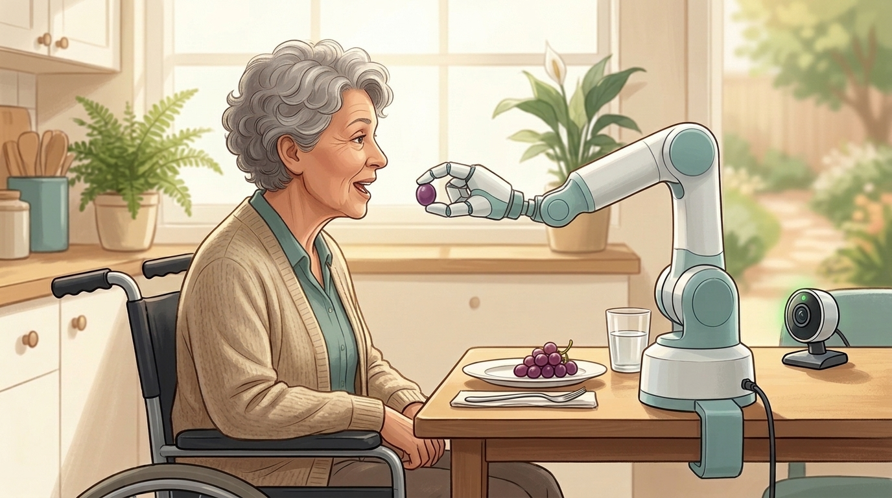
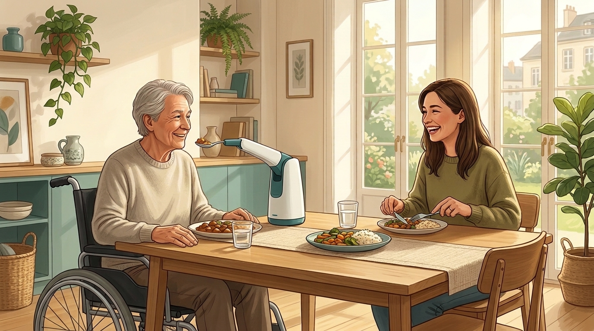
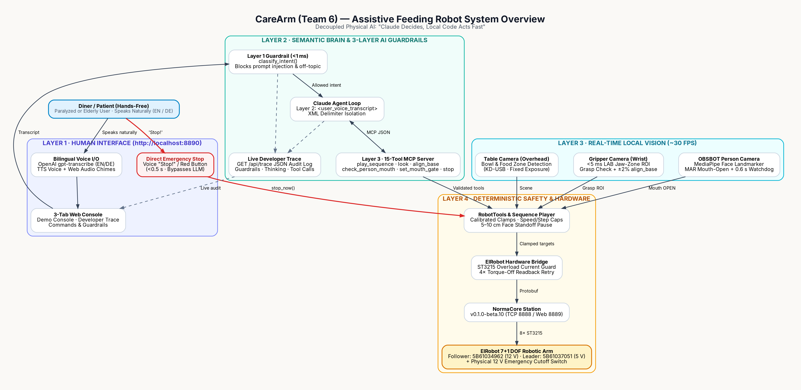
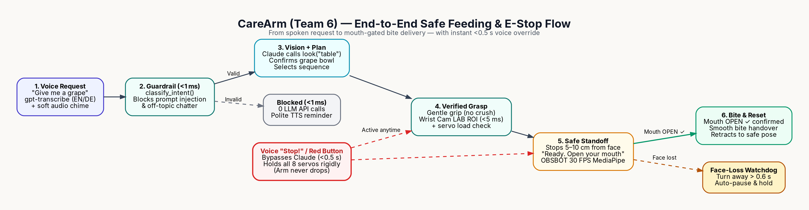

# CareArm — Assistive Feeding Robot (Team 6)

[](docs/FEEDING_ASSISTANT_PLAN.md)
[](docs/elrobot_hardware_bridge.md)
[](tests/)
[](requirements.txt)
[](LICENSE)

**2nd Edition Berlin Robotics & AI Hackathon (HackLab × BRISA · November 21–22, 2026)**
**Team 6:** Jan Schulz · Jafer Sharfeddin · Mohammad El-Musleh

> **CareArm: Hands-Free, Voice-Controlled Assistive Feeding Robot — Restoring Mealtime Independence Safely & Affordably.**

## 🎥 Demo & Presentation

[](https://youtu.be/h6ilZ18guAE)

| | |
| :--- | :--- |
| **Demo video** | [youtu.be/h6ilZ18guAE](https://youtu.be/h6ilZ18guAE) |
| **Final presentation (PDF, 9 slides)** | [docs/pitch/CareArm_Presentation.pdf](docs/pitch/CareArm_Presentation.pdf) |
| **Architecture & flow diagrams** | [System Overview (PDF)](docs/diagrams/carearm_overview.pdf) · [Safe Feeding Flow (PDF)](docs/diagrams/carearm_feeding_sequence.pdf) |
| **Documentation index** | [docs/README.md](docs/README.md) |

> **Demo status:** in the hackathon demo, Claude chose the action from the voice request and camera context, and the arm executed **recorded waypoint sequences** for that action. AprilTag/IK-based moves and a learned grasp policy (ACT) are the next steps.

---

## Human-Centered Use Case

Millions of elderly and paralyzed individuals depend on a caregiver for every single bite — **1,095 assisted meals every year**. Commercial feeding arms cost **$6,000–$12,000+** and still rely on manual chin-switches or joysticks.

With **CareArm**, a diner simply speaks naturally in English or German (*"Give me a grape"*, *"Now some chocolate"*). The arm sees the table, verifies a gentle non-crushing grasp, pauses respectfully **5–10 cm** in front of the diner's face, and waits for a real-time **MediaPipe Mouth-Open confirmation** before handing over the bite.

| Respectful 5–10 cm Standoff & Mouth-Open Cue | Restored Shared Family Dinners |
| :---: | :---: |
|  |  |

*Illustrations of the use case, not photos of the prototype. See the demo video for the real robot.*

---

## Core Architecture: *"Claude Decides, Local Code Acts Fast"*

Most LLM-to-robot prototypes send raw camera images and raw motor commands straight through a cloud model — far too slow (2–4 s) and unsafe near a human face. CareArm strictly decouples **open-ended semantic reasoning** from **30 FPS local perception and deterministic hardware safety**:



### End-to-End Safe Feeding & Emergency-Stop Flow



### Key Technical Pillars
- **Semantic Brain (Claude + 15-Tool MCP Server):** Natural-language food understanding (`look`, `play_sequence`, `align_base`, `check_person_mouth`, `set_mouth_gate`, `stop`) protected by **3-layer scope guardrails** (`<1 ms` pre-LLM prompt-injection/off-topic gatekeeper, `<user_voice_transcript>` XML delimiter isolation, whitelisted MCP schemas) and a live **Developer Action Trace** (`GET /api/trace`).
- **3-Camera Closed-Loop Vision (~30 FPS):**
  - **Table Camera (Overhead):** Bowl & food zone detection + AprilTag table frame calibration.
  - **Gripper Camera (Wrist):** `<5 ms` LAB color-contrast jaw-zone ROI check + ST3215 servo load verification + bounded `±2%` base alignment nudges.
  - **Person Camera (OBSBOT Meet SE):** MediaPipe Face Landmarker (`landmarks 13, 14, 61, 291`) computing smoothed Mouth Aspect Ratio (**MAR**) with 1-click per-user calibration, 3-frame debounce, and a **0.6 s face-loss watchdog**.
- **AprilTag Table Frame & URDF Inverse Kinematics:** Full tabletop TCP calibration (`src/arm_kinematics.py`, `src/tag_calibration.py`, `scripts/calib.py`) and modular feeding skills (`.claude/skills/hover-above-object`, `grip-object`, `drop-in-bowl`) alongside recorded waypoint trajectories (`config/sequences.json`).
- **Deterministic Hardware Safety:** Calibrated joint clamps, velocity & per-leg step caps, ST3215 current overload guard, 4× torque-off readback verification, `<0.5 s` **bypass-LLM Emergency Stop** (holds pose rigidly so the arm never drops), and a physical 12 V power cutoff.

---

## Verified Benchmarks & Test Coverage

| Area | Metric / Benchmark | Verified Result |
| :--- | :--- | :--- |
| **Automated Test Suite** | `.venv/bin/python -m pytest tests/` (offline + fake-arm) | **100% passing (`170 / 170` tests)** |
| **AI Scope Guardrails** | `classify_intent()` pre-LLM prompt-injection & off-topic gate | **< 1 ms latency · 0 API calls** |
| **Emergency Stop** | Voice `"Stop!"` or red button (`stop_now()` bypasses Claude) | **< 0.5 s pose-hold halt** |
| **Mouth-Open Safety Gate** | OBSBOT MediaPipe MAR (`Closed ~0.01 → Open ~0.35+`) | **30 FPS · 0.6 s face-loss watchdog** |
| **Wrist Grasp Verification** | Jaw-zone LAB contrast ROI + ST3215 servo load dual check | **< 5 ms visual check** |
| **Bilingual Voice Control** | OpenAI `gpt-transcribe` (EN/DE) + TTS & Web Audio chimes | **Hands-free (~1.5 s STT)** |

---

## Quickstart

### 1. Configure Environment & Run Tests (No Hardware Required)
```bash
cp .env.example .env                    # Add ANTHROPIC_API_KEY & OPENAI_API_KEY
.venv/bin/python -m pytest tests/ -q    # Run full offline test suite
```

### 2. Launch the 3-Tab Voice & Vision Console
```bash
# Terminal 1: Start NormaCore Station (TCP 8888, Web Viewer 8889)
./cli.sh station

# Terminal 2: Launch Hands-Free Console (http://localhost:8890)
./cli.sh console 8890
```

### 3. Read-Only Hardware Preflight & Bench Tools
```bash
./cli.sh preflight --bus 5B61034962     # Verify 8/8 ST3215 motors, calibration & fault status
./cli.sh reset                          # Relax leader torque / apply manual camera exposure
./cli.sh hw stop                        # Emergency torque-off (4x readback verified)
```

---

## Master CLI Commands (`./cli.sh`)

| Command | Action |
| :--- | :--- |
| `./cli.sh console [port]` | Launch 3-tab Web Console (`Demo Console`, `Developer Trace`, `Guardrails`) at `http://localhost:8890` |
| `./cli.sh start [port]` | Launch Mission Control Web Dashboard (1-click per-user mouth calibration) at `http://localhost:8080` |
| `./cli.sh station` | Start NormaCore Station runtime (`./bin/station --web --tcp`) |
| `./cli.sh mcp` | Run the 15-tool `elrobot` MCP server over stdio (`src/robot_mcp_server.py`) |
| `./cli.sh test [filter]` | Run offline pytest suite |
| `./cli.sh preflight` | Read-only 8-motor ElRobot readiness check |
| `./cli.sh hw record / play` | Record waypoint trajectories and play sequences with settle & overload guards |
| `./cli.sh hw stop` | Emergency stop on all 8 ST3215 motors |
| `./cli.sh teleop` | 50 Hz Leader → Follower mirroring |
| `./cli.sh cameras` | Apply fixed manual exposure to KD-USB cameras (Station stopped) |
| `./cli.sh reset` | Quick bench recovery |
| `./cli.sh sync` | Safe git sync + pinned NormaCore submodule check |

---

## Repository Structure

```text
├── src/                        # Core Python robotics, vision, MCP & console stack
│   ├── console_agent.py        # Claude Messages API loop, 3-layer guardrails & live Developer Trace
│   ├── web_console.py          # Starlette/Uvicorn server (3-camera feeds, STT, TTS, /api/trace, /api/mouth_status)
│   ├── web/console.html        # 3-tab Hands-Free Voice Console UI + live Mouth badge & Dev Log toggle
│   ├── robot_mcp_server.py     # 15-tool stdio MCP server (elrobot)
│   ├── robot_tools.py          # Hardware-safe robot actions, sequence slicing, align_base & mouth gate
│   ├── sequence_player.py      # Multi-waypoint trajectory runner with settle checks & after_leg hooks
│   ├── feeding_vision.py       # 3-camera vision: MediaPipe FaceLandmarker MAR, table bowl/food, gripper LAB ROI
│   ├── arm_kinematics.py       # URDF forward/inverse kinematics for ElRobot 7+1 DOF
│   ├── tag_calibration.py      # AprilTag 36h11 table-frame homography & camera-to-base calibration
│   ├── action_space.py         # Leader-recorded safety envelope for bounded joint nudges
│   ├── elrobot_hardware.py     # NormaCore Station SDK bridge, joint clamps, overload guard & 4x torque readback
│   ├── elrobot_camera.py       # Cross-platform (Linux/macOS) USB-port camera discovery & decoding
│   ├── speech.py               # OpenAI gpt-transcribe bilingual (EN/DE) speech-to-text
│   └── digital_twin_server.py  # Mission Control dashboard & 1-click per-user mouth calibration
├── scripts/                    # Hardware-day CLI, calibration, pitch & media generators
├── config/                     # Committed calibration, joint waypoints, sequences & safety envelope
├── tests/                      # 170 offline unit & integration tests (zero hardware required)
├── docs/                       # Organized pitch decks, diagrams, illustrations & active guides (see docs/README.md)
├── .claude/skills/             # Modular Claude feeding skills (hover-above-object, grip-object, drop-in-bowl)
├── .env.example                # Environment variable template (never commit .env)
├── LICENSE                     # MIT License
└── cli.sh                      # Unified project runner
```

---

## Team 6 Roster

| Member | Contact |
| :--- | :--- |
| **Jan Schulz** | `jan.schulz@cileria.com` |
| **Jafer Sharfeddin** | `j.sharfeddin@gmail.com` |
| **Mohammad El-Musleh** | `elmusleh.mohammad@gmail.com` |

Licensed under the [MIT License](LICENSE).
