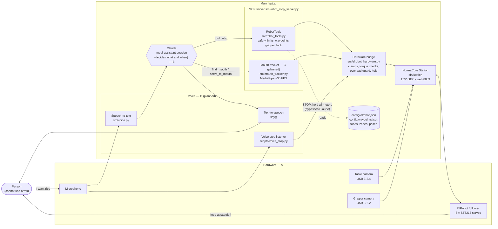
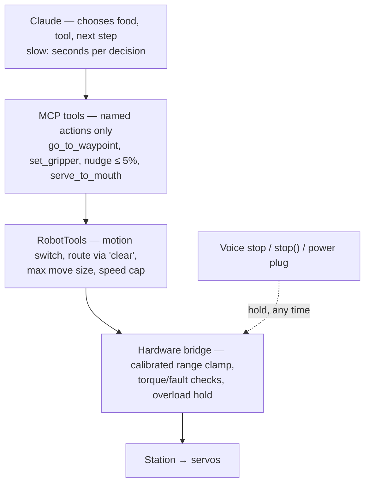
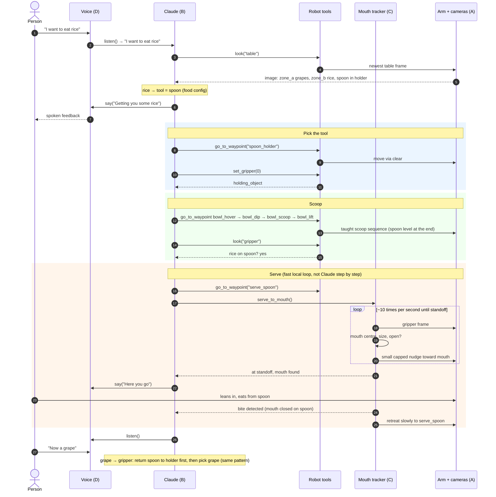
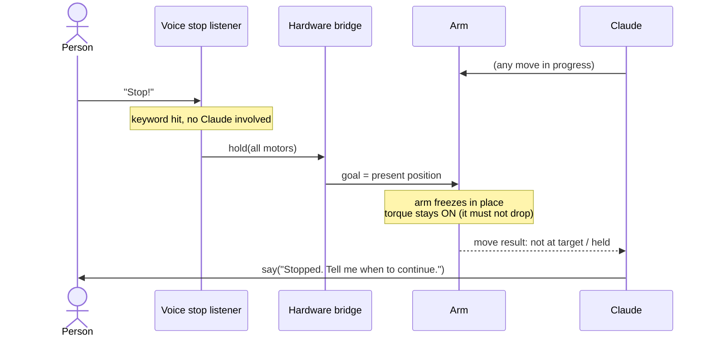
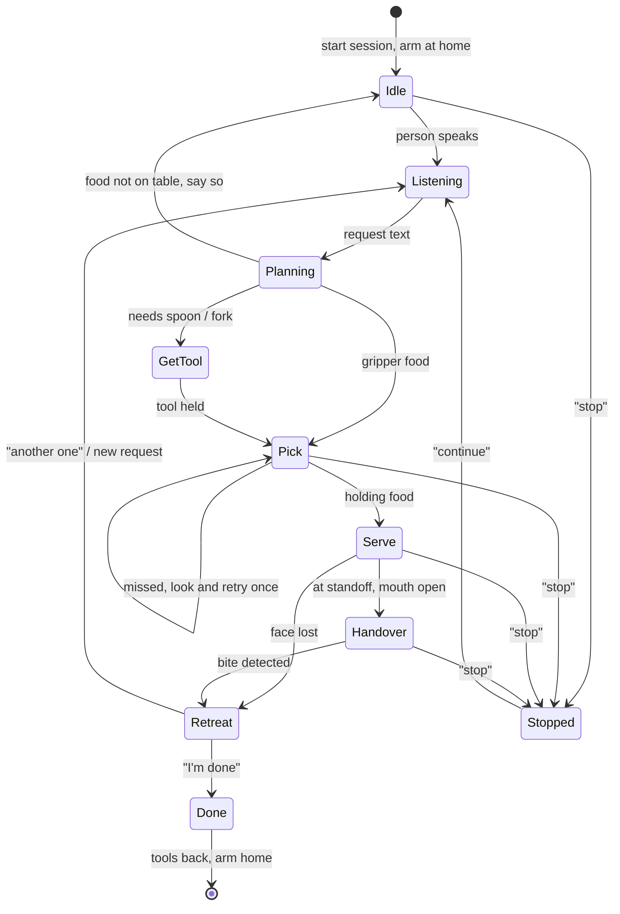
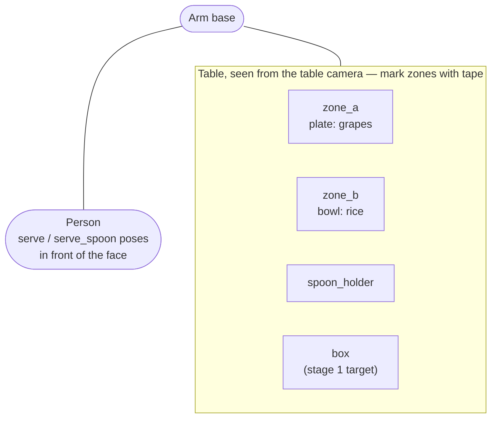
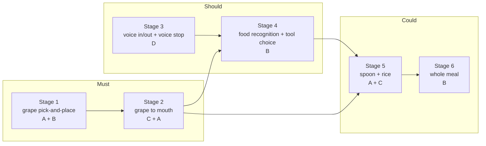
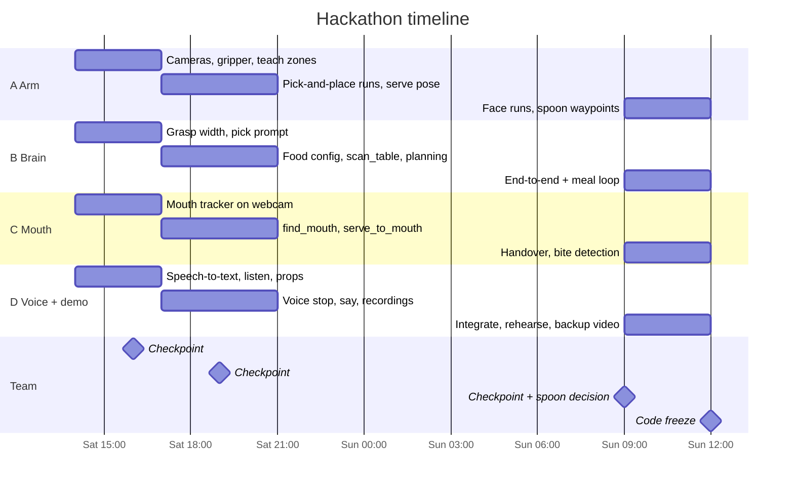

# Feeding Assistant: Diagrams

Visual companion to [FEEDING_ASSISTANT_PLAN.md](FEEDING_ASSISTANT_PLAN.md). GitHub and VS Code
(with a Mermaid preview extension) draw these as pictures. Boxes marked *planned* do not exist yet.

## 1. System model: who talks to whom

**Read it as:** the person speaks → Claude decides → tools move the arm through the safety layers →
the Station drives the servos and records the cameras. Two paths skip Claude on purpose: the **voice stop**
(must be instant) and the **mouth approach loop** (must be fast).

## 2. Layers: what is allowed to move the arm

Nothing above layer 4 can send raw motor commands. That is the safety story for the pitch.

## 3. Sequence: "I want to eat rice" (full scenario)

## 4. Sequence: voice "stop" during a move

Target: arm frozen within 0.5 s of the word.

## 5. Meal session: states

## 6. Table layout (fixed zones)

Each zone has taught poses (`zone_a_hover`, `zone_a`, ...). Claude decides *what is in which zone*;
the waypoints decide *how to get there*.

## 7. Build order and who does what

